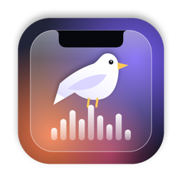
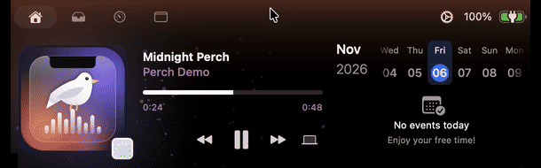
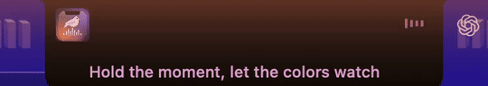
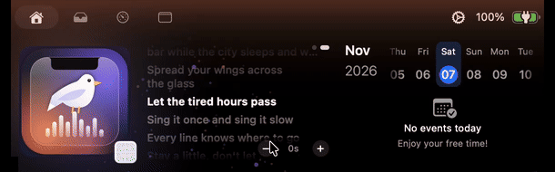
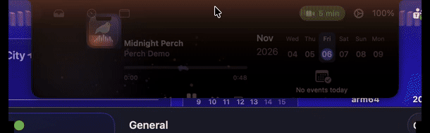

<div align="center">



# Perch

**A small hub that lives in your MacBook's notch.**<br>
Music with visualizers and synced lyrics, system stats, calendar reminders,<br>
the menu bar icons the notch hides, and quick alerts, all around the camera.

[](https://github.com/trieuluan/perch-mac/releases/latest)
[](https://github.com/trieuluan/perch-mac/releases)

[](./LICENSE)

[**Download Perch.dmg**](https://github.com/trieuluan/perch-mac/releases/latest/download/Perch.dmg) · `brew install --cask trieuluan/perch/perch`

<br>



</div>

## Features

### 🎵 Visualizers that hear the music

Perch analyzes what your Mac is playing, on-device, and follows 24 frequency bands, the lead melody, drum hits and how bright the sound is. It shows up behind the player (7 styles), next to the album art in the closed notch, and across the menu bar (11 styles), in colors taken from the album art or your own gradient.


### 🎤 Synced lyrics

The line being sung shows under the closed notch, and long lines glide sideways so you can read them to the end. Open the notch and swipe the player with two fingers to see the whole song, karaoke style: click a line to jump there, or nudge the timing when a music video runs early. Lyrics come from [LRCLIB](https://lrclib.net), with Vietnamese titles and YouTube-style names handled.

<table>
<tr>
<td width="45%" valign="top"></td>
<td width="55%" valign="top"></td>
</tr>
</table>

### 🔔 Alerts in the notch

Short messages beside the camera when something happens: an event is about to start, a reminder is due, the Mac is overloaded (and which app is responsible), headphones connect (with battery), the keyboard input source changes, or Caps Lock turns on.


<table>
<tr>
<td width="55%" valign="top">

### 📅 Join meetings from the notch

A few minutes before a meeting, the open notch shows a pill with the time left. Click it to join Google Meet, Zoom, Microsoft Teams, Webex, Slack huddles or FaceTime, in the native app when it's installed.



</td>
<td width="45%" valign="top">

### 📊 System at a glance

The **System** tab shows CPU, memory, network and battery with live sparklines.

### 🙈 Icons hidden by the notch

On a crowded menu bar, macOS hides icons behind the notch. The **Menu Bar** tab lists them, with their real icons, and opens their menus.

### 🎧 Audio output picker

Switch between speakers, AirPods and other outputs from a button in the player.

</td>
</tr>
</table>

Perch also keeps everything from Boring Notch: the music player, calendar, file shelf, system HUDs, battery and webcam mirror. It's available in **English** and **Vietnamese** (Tiếng Việt), following your Mac's language.

## Install

Requires **macOS 14 Sonoma or later** (visualizers need 14.2+).

**With Homebrew** (recommended):

```bash
brew install --cask trieuluan/perch/perch
```

**Or download** [`Perch.dmg`](https://github.com/trieuluan/perch-mac/releases/latest/download/Perch.dmg) and drag Perch into Applications.

Perch isn't notarized by Apple yet, so macOS blocks a downloaded copy the first time you open it. Go to **System Settings › Privacy & Security**, find the message about Perch, and click **Open Anyway**. Or run:

```bash
xattr -dr com.apple.quarantine /Applications/Perch.app
```

The Homebrew cask does this for you. After that, Perch updates itself.

### Permissions

| Permission | Used for |
| --- | --- |
| **System Audio Recording** | Visualizers. Audio is analyzed on-device, never recorded or sent anywhere. Without it, visualizers fall back to a simple animation. |
| **Accessibility** | Showing and opening menu bar icons hidden by the notch. |
| **Calendars & Reminders** | The calendar, event reminders and the Join button. |

## Settings

Everything can be turned on or off:

- **Settings → Visualizer**: styles for the player background and the menu bar, intensity, and colors (from the album art, monochrome, or your own gradient with presets).
- **Settings → Media**: lyrics, and the lyric line under the closed notch.
- **Settings → General**: the Menu Bar and System tabs, each kind of notch alert, and how many minutes before an event to remind you. **Preview** buttons let you try the alerts.

## Roadmap

- [x] Real audio visualizers in the notch, the player and the menu bar
- [x] Menu bar icons hidden by the notch, with their real icons
- [x] Perch's own app icon
- [x] Releases with automatic updates (DMG, Homebrew, Sparkle)
- [x] System stats and overload alerts
- [x] Input source, Caps Lock and headphone alerts, audio output picker
- [x] Event reminders and one-click meeting join
- [x] Synced lyrics under the notch and in the player
- [x] Vietnamese translation
- [ ] Better web music support (Zing MP3, NhacCuaTui, SoundCloud…), with a browser extension for sites that don't report what's playing
- [ ] Developer ID signing and notarization
- [ ] More widgets: timers, downloads, AirDrop

## Development

<details>
<summary><b>Building from source</b></summary>

Requirements: **macOS 15.6+** and **Xcode 26+**.

```bash
git clone https://github.com/trieuluan/perch-mac.git
cd perch-mac
open boringNotch.xcodeproj
```

Then press `Cmd + R` in Xcode.

**Keep permissions across rebuilds (optional).** By default, Debug builds are signed ad-hoc, so macOS forgets Accessibility and other permissions after every build. To avoid that, create `Configuration/Local.xcconfig` (it's gitignored) with your team:

```
DEVELOPMENT_TEAM = YOURTEAMID
CODE_SIGN_IDENTITY[sdk=macosx*] = Apple Development
```

A free Personal Team works.

**Code layout.** Perch-specific code lives in `boringNotch/Perch/` (plus helpers in `BoringNotchXPCHelper/`), with small hooks in upstream files marked `// Perch`. Internal folder, target and scheme names still say `boringNotch`. Both choices keep upstream changes merging cleanly.

</details>

<details>
<summary><b>Releasing</b></summary>

Releases are built and published from a Mac, with no CI secrets. First set `MARKETING_VERSION` in the project to the new version and commit, then:

```bash
Configuration/release/release.sh 1.2.0            # dry run: build, DMG, appcast, cask
Configuration/release/release.sh 1.2.0 --publish  # tag, GitHub release, Homebrew tap
```

The script uses your `gh` login and the Sparkle EdDSA key stored in your Keychain under the account `perch` (created with Sparkle's `generate_keys --account perch`). Back that key up: without it, existing installs can't verify future updates. The appcast is attached to each GitHub release, and the app reads it from `releases/latest/download/appcast.xml`.

</details>

<details>
<summary><b>Staying in sync with upstream</b></summary>

```bash
git remote add upstream https://github.com/TheBoredTeam/boring.notch.git  # once
git fetch upstream
git merge upstream/main
```

</details>

## Credits

Perch is a fork of **[Boring Notch](https://github.com/TheBoredTeam/boring.notch)** by TheBoredTeam and contributors, and like the original it is licensed under **GPL-3.0** (see [LICENSE](./LICENSE)).

- **[MediaRemoteAdapter](https://github.com/ungive/mediaremote-adapter)**, for Now Playing access on macOS 15.4+.
- **[NotchDrop](https://github.com/Lakr233/NotchDrop)**, which inspired the original Shelf feature.
- **[Sparkle](https://sparkle-project.org)**, for updates.

For third-party licenses, see [THIRD_PARTY_LICENSES](./THIRD_PARTY_LICENSES).
